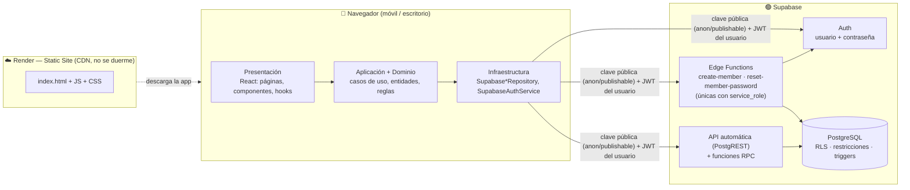
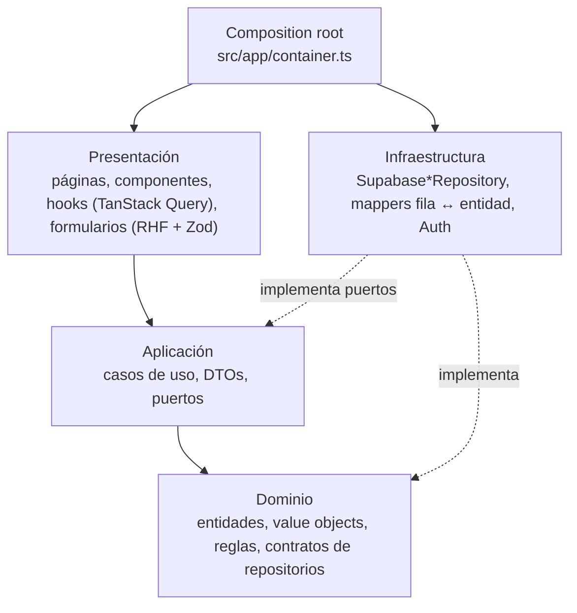

# 1. Arquitectura general

> **Decisión vigente (v1): solo frontend + Supabase.** La SPA React se publica como *Static Site* en Render y
> habla directamente con Supabase. No hay servidor Node en la v1. La lógica que **no puede** vivir en el navegador
> (seguridad, amigo secreto, límites de votos) vive en PostgreSQL —políticas RLS,
> restricciones, triggers y funciones RPC— y la creación de usuarios en Edge Functions de Supabase. Ver ADR A1 en [05-decisiones-riesgos.md](05-decisiones-riesgos.md).
>
> Esto se aparta del prompt maestro (§2 pedía una API REST en Node.js). Queda preparado para agregarla después
> sin tocar componentes ni casos de uso (ver §1.4).

## 1.1. Vista general



**Puntos clave**

1. **La clave pública de Supabase está en el navegador, y eso es normal.** La seguridad no depende de esconderla
   sino de que **todas** las tablas tengan RLS activa y bien probada. La clave `service_role` **jamás** va al frontend.
2. **RLS pasa a ser la defensa principal** (antes era la segunda). Toda regla de permisos de la
   [matriz](03-permisos-seguridad.md#32-matriz-de-permisos) se escribe como política SQL.
3. **Operaciones sensibles = funciones RPC** (`security definer`) con su propia validación:
   descubrir el amigo secreto, marcar una responsabilidad como hecha, votar con límite, fusionar juegos y crear el evento con su organizador.
4. **Familiares sin correo:** el organizador les **crea usuario y contraseña** desde la app. Eso lo ejecuta una
   **Edge Function de Supabase** (`create-member`), porque requiere la clave `service_role`, que nunca va al
   navegador. Internamente cada usuario tiene un correo ficticio que la persona nunca ve
   (ver [03-permisos-seguridad.md §3.2](03-permisos-seguridad.md#32-usuarios-creados-por-el-administrador)).
5. **No se importa Supabase en componentes:** el cliente vive en `src/shared/infrastructure/supabase/client.ts`
   y solo lo importan carpetas `infrastructure/` (regla de ESLint `no-restricted-imports`).

## 1.2. Capas (Clean Architecture dentro del frontend)



| Capa | Puede importar | Nunca importa |
|---|---|---|
| Dominio | nada externo | React, Supabase, Zod |
| Aplicación | Dominio | Supabase, React |
| Infraestructura | Dominio, Aplicación, `@supabase/supabase-js` | React |
| Presentación | Aplicación (vía hooks y container), `shared/ui` | `@supabase/*`, `infrastructure/` |

Los hooks llaman a casos de uso, no a repositorios:

```typescript
// modules/wishlist/presentation/hooks/useAddWishlistItem.ts
export function useAddWishlistItem() {
  const { addWishlistItem } = useContainer();          // inyectado desde container.ts
  const qc = useQueryClient();
  return useMutation({
    mutationFn: (input: AddWishlistItemDTO) => addWishlistItem.execute(input),
    onSuccess: () => qc.invalidateQueries({ queryKey: ['wishlist'] }),
  });
}
```

## 1.3. Desacoplamiento de Supabase

| Servicio | Contrato | Implementación v1 | Futuro |
|---|---|---|---|
| Datos | `IEventRepository`, `IParticipantRepository`, `IWishlistRepository`, … | `Supabase*Repository` (supabase-js) | `Http*Repository` (API Node propia) |
| Operaciones sensibles | métodos de repositorio/servicio (`revealMySecretFriend`, `markResponsibilityDone`, `castVote`) | llamadas `supabase.rpc(...)` | endpoints REST |
| Auth | `IAuthService` (`signInWithPassword`, `signUp`, `startGuestSession`, `signOut`, `onChange`) | `SupabaseAuthService` | Auth0, Entra ID, auth propio |
| Storage (cuando se habiliten fotos) | `IStorageService` (`upload`, `getSignedUrl`, `remove`) | `SupabaseStorageService` | S3, Cloudinary |
| Gestión de usuarios | `IMemberAccountService` (`create`, `resetPassword`, `disable`) | llamadas a Edge Functions | endpoints de la API |
| Invitaciones | `IInvitationService` (crear, construir enlace de WhatsApp, revocar) | caso de uso + RPC | API |

Ningún tipo de Supabase (`PostgrestError`, `User`, `Session`) sale de `infrastructure/`: los mappers convierten
filas en entidades y errores de Supabase en errores de dominio (`NotAllowedError`, `DuplicateNameError`, …).

## 1.4. Camino de migración (cuando haga falta)

1. Crear la API Node (Express) y mover allí la lógica de las RPC.
2. Escribir `Http*Repository` en el frontend implementando **las mismas interfaces**.
3. Cambiar las líneas correspondientes en `container.ts`.

Los componentes, hooks, casos de uso y entidades no cambian. Para pasar a SQL Server, esa API usaría
`SqlServer*Repository` del lado servidor.

**Cuándo conviene agregar la API:** integraciones con secretos (WhatsApp Business, SMS), tareas programadas
complejas, procesamiento de imágenes en servidor o un cambio de base de datos.

## 1.5. Estructura de carpetas

Un solo proyecto Vite (sin monorepo; se agrega cuando exista la API).

```
navidad-en-familia/
├─ src/
│  ├─ app/
│  │  ├─ container.ts          # composition root: instancia repositorios y casos de uso
│  │  ├─ router.tsx            # React Router
│  │  ├─ providers.tsx         # TanStack Query, container, tema, tamaño de letra
│  │  └─ layout/               # barra inferior móvil / lateral escritorio
│  ├─ modules/
│  │  ├─ events/
│  │  │  ├─ domain/            # Event.ts, IEventRepository.ts, reglas
│  │  │  ├─ application/       # CreateEvent.ts, dtos/
│  │  │  ├─ infrastructure/    # SupabaseEventRepository.ts, EventMapper.ts
│  │  │  └─ presentation/      # pages/, components/, hooks/
│  │  ├─ onboarding/ participants/ families/ invitations/ gift-exchange/ wishlist/
│  │  ├─ responsibilities/ games/ schedule/ announcements/ checklist/ accounts/ admin/
│  ├─ shared/
│  │  ├─ domain/               # PersonName, Money, errores de dominio
│  │  ├─ application/ports/    # IAuthService, IMemberAccountService, IClock
│  │  ├─ infrastructure/
│  │  │  ├─ supabase/client.ts # ÚNICO createClient()
│  │  │  ├─ auth/SupabaseAuthService.ts
│  │  ├─ validation/           # esquemas Zod + normalizeName
│  │  ├─ ui/                   # Button, Card, TextField, BigActionButton, Toast…
│  │  └─ lib/                  # fechas/zona horaria, moneda, enlace de WhatsApp
│  └─ main.tsx
├─ supabase/
│  ├─ migrations/              # 0001_schema.sql, 0002_rls.sql, 0003_rpc.sql
│  ├─ functions/               # Edge Functions: create-member, reset-member-password, disable-member
│  ├─ tests/                   # pgTAP: RLS y RPC por rol
│  └─ seed.sql
├─ docs/
├─ .env.example                # VITE_SUPABASE_URL, VITE_SUPABASE_PUBLISHABLE_KEY
└─ render.yaml                 # Static Site + regla de reescritura para React Router
```

## 1.6. Validación en dos lugares

Sin servidor Node, la validación del "backend" que exige el requerimiento la hace **PostgreSQL**:

| Regla | Frontend (mensajes claros) | Base de datos (no se puede saltar) |
|---|---|---|
| Normalizar nombres | `normalizeName()` al escribir/guardar | trigger `BEFORE INSERT/UPDATE` con `app.normalize_name()` |
| Nombre no vacío y solo letras | Zod | `CHECK` |
| Duplicados en el evento | aviso "¿Eres tú?" | índice único `(event_id, name_key, distinguishing_note)` |
| Precio ≥ 0, prioridad 1..3 | Zod | `CHECK` |
| Máximo de votos | botón deshabilitado | RPC `cast_vote` + trigger |
| Permisos | ocultar acciones no permitidas | RLS |

```typescript
// src/shared/validation/normalizeName.ts
const VALID_NAME = /^[\p{L}\p{M}][\p{L}\p{M}' .-]*$/u;

export function normalizeName(raw: string): string {
  return raw
    .normalize('NFC')
    .replace(/[\s ]+/g, ' ')
    .trim()
    .toLocaleUpperCase('es-PE');
}
```

```sql
-- supabase/migrations: misma regla en la base
create function app.normalize_name(raw text) returns text
language sql immutable as $$
  select upper(btrim(regexp_replace(normalize(raw, NFC), '\s+', ' ', 'g')))
$$;
```

| Entrada | Resultado |
|---|---|
| `hugo` | `HUGO` |
| `  hugo  ` | `HUGO` |
| `hUGo garcía` | `HUGO GARCÍA` |
| `María   López` | `MARÍA LÓPEZ` |
| `josé pérez` | `JOSÉ PÉREZ` |
| `   ` | ❌ "Escribe tu nombre" |
| `Hugo2` | ❌ "El nombre solo puede tener letras" |

## 1.7. Despliegue

- **Render Static Site**: gratuito, servido desde CDN y **no se duerme** (el riesgo de demora de 30–60 s
  desaparece). Regla de reescritura `/* → /index.html` para que funcionen enlaces como `/i/<token>`.
- Variables de entorno de build: `VITE_SUPABASE_URL` y `VITE_SUPABASE_PUBLISHABLE_KEY` (públicas por diseño).
- Entornos: Supabase local (CLI + Docker) para desarrollo; un proyecto Supabase de pruebas y uno de producción,
  cada uno con su Static Site en Render (ramas `develop` y `main`).
