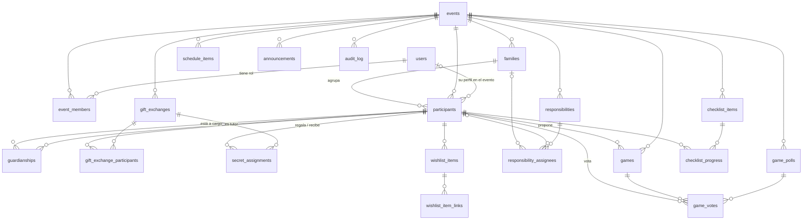

# 2. Modelo de datos

PostgreSQL (Supabase). Las tablas viven en `public` y el navegador las consulta directamente con la clave
pública; por eso **todas tienen RLS activa** sin excepción (una prueba de CI falla si alguna tabla queda sin RLS).
`secret_assignments` **no** tiene política de lectura para participantes: solo se accede por una función RPC.
Las funciones auxiliares y las RPC viven en el esquema `app`.

Convenciones: `id uuid` (`gen_random_uuid()`), `created_at`/`updated_at timestamptz`, `deleted_at` para borrado
lógico donde tiene sentido, nombres en `snake_case`, montos `numeric(10,2)`, moneda por evento (`PEN`).

## 2.1. Revisión de redundancias de la lista inicial

| Entidad del requerimiento | Decisión | Motivo |
|---|---|---|
| `users` | ✅ Perfil de cuenta con **`username`** | Cada familiar entra con usuario y contraseña que **crea el administrador**. No se pide correo. |
| `event_members` | ✅ Roles del evento: `owner`, `admin`, `editor`, `participant` | Una sola tabla de roles por cuenta y evento. |
| `participants` | ✅ Núcleo del modelo | Perfil dentro del evento. `user_id` es opcional: un niño puede no tener usuario y lo maneja su tutor. |
| `families` | ✅ | — |
| `family_members` | ❌ Se elimina [PROPUESTA D4] | Un participante pertenece a una familia: `participants.family_id`. |
| `guardians` | ✅ Como `guardianships` (D7) | Un padre o madre administra los perfiles de sus hijos, tengan o no usuario propio. |
| `invitations` | ❌ **Fuera de la v1** | Ya no hay registro por enlace: el administrador crea las cuentas y envía el enlace de la app + usuario + contraseña. |
| `gift_exchanges`, `secret_assignments` | ✅ | — |
| `wishlist_items` | ✅ **sin foto** en la v1 + nueva `wishlist_item_links` | Varios enlaces por regalo ("este polo en Saga, este en Falabella"). |
| `responsibilities` + `contributions` | 🔀 Se fusionan en `responsibilities` con `kind` [PROPUESTA D6] | Misma estructura: responsables, estado y fecha. |
| `games`, `game_votes` | ✅ + `game_polls` | Los participantes agregan ideas de juegos y actividades sin aprobación previa y votan; administradores y editores pueden fusionar las repetidas. |
| `event_schedule` | ✅ Como `schedule_items` | — |
| `announcements` | ✅ | — |
| `checklist_items`, `checklist_progress` | ✅ | — |
| `event_settings` | ❌ Se elimina | Columnas de `events` y `gift_exchanges`. |
| — | ➕ `responsibility_assignees` | Varios responsables (personas o familias) por responsabilidad. |
| — | ➕ `audit_log` | Acciones sensibles: crear usuarios, restablecer contraseñas, abrir el sello del sorteo. |

## 2.2. Diagrama entidad-relación

## 2.3. Tablas

### Cuentas, eventos y roles

**users** — perfil de cada cuenta (organizador o familiar)
| Columna | Tipo | Notas |
|---|---|---|
| id | uuid PK | igual a `auth.users.id` |
| username | citext UNIQUE NOT NULL | p. ej. `rosa.garcia`; minúsculas, sin espacios; único en toda la plataforma |
| display_name | text | |
| real_email | citext | opcional: solo el organizador (para recuperar su contraseña) |
| must_change_password | boolean DEFAULT false | [PROPUESTA] no se obliga en la v1 |

**events** — `owner_user_id`, `name`, `organizer_name`, `description`, `celebration_at timestamptz`,
`timezone DEFAULT 'America/Lima'`, `currency DEFAULT 'PEN'`, `status`, `deleted_at`.

**event_members** — PK `(event_id, user_id)`, `role: owner | admin | editor | participant`.
Exactamente un `owner` por evento.

### Personas

**families** — `event_id`, `name` (MAYÚSCULAS), `color_key` (paleta cerrada con contraste verificado),
`dress_code_note` [PROPUESTA D9], UNIQUE `(event_id, name)`.

**participants**
| Columna | Tipo | Notas |
|---|---|---|
| event_id | FK NOT NULL | |
| family_id | FK families | |
| user_id | FK users | opcional. Un niño puede tener su propio usuario **o no**; en ambos casos puede tener tutores (D7). UNIQUE `(event_id, user_id)` |
| first_name, paternal_surname | text NOT NULL | normalizados por trigger; CHECK no vacío |
| maternal_surname | text | opcional |
| full_name | text GENERATED | |
| name_key | text NOT NULL | clave para detectar duplicados |
| distinguishing_note | text | para homónimos: "HIJO", "PADRE" |
| status | `active \| removed` | |
| | | UNIQUE `(event_id, name_key, coalesce(distinguishing_note,''))` WHERE `status = 'active'` |

**guardianships** — `guardian_participant_id`, `ward_participant_id`, `event_id`; CHECK tutor ≠ persona a cargo.

### Regalos

**gift_exchanges** — `name`, `budget_max numeric(10,2) DEFAULT 65.00`, `delivery_at`, `status`,
`assignments_sealed boolean DEFAULT false`.

**gift_exchange_participants** — PK `(exchange_id, participant_id)`.

**secret_assignments** — `giver_participant_id`, `receiver_participant_id`, `revealed_at`;
UNIQUE por giver y por receiver en cada intercambio; CHECK giver ≠ receiver.

**wishlist_items**
| Columna | Tipo | Notas |
|---|---|---|
| participant_id | FK | dueño del deseo |
| title | text NOT NULL | "Polo", "Colonia", "Billetera" |
| description | text | talla, color, marca, modelo… |
| price_estimate | numeric(10,2) | opcional, CHECK ≥ 0 |
| priority | smallint 1..3 DEFAULT 2 | "Me encantaría / Me gustaría / Si se puede" |
| sort_order | int | |
| created_by_user_id | FK users | quién la cargó (la persona, su tutor o el organizador) |
| deleted_at | timestamptz | |

> **Sin fotos en la v1.** La columna `image_path` se agregará con una migración cuando se habilite.

**wishlist_item_links** — `item_id`, `url` (CHECK solo `http://` o `https://`), `label` opcional ("Saga Falabella"),
`sort_order`. Máximo 5 enlaces por regalo [PROPUESTA].

### Organización

**responsibilities** — `kind: task | contribution`, `category`, `title`, `description`, `due_at`,
`status: pending | in_progress | done`, `notes`, `completed_by_user_id`, `completed_at`.

**responsibility_assignees** — `participant_id` **o** `family_id` (CHECK exactamente uno).

**games** — ideas de juegos y actividades. **Entran directo, sin aprobación** (D17).
| Columna | Tipo | Notas |
|---|---|---|
| proposed_by_participant_id | FK | quién tuvo la idea |
| responsible_participant_id | FK | opcional |
| name | text NOT NULL | |
| name_key | text NOT NULL | nombre normalizado (MAYÚSCULAS, sin tildes, sin espacios dobles) para detectar repetidos |
| category, description, duration_minutes, min_players, max_players, materials, instructions | | CHECK min ≤ max |
| status | `active \| merged \| played \| removed` | |
| merged_into_game_id | FK games | si fue fusionado, apunta al juego resultante |
| | | UNIQUE `(event_id, name_key)` WHERE `status = 'active'` → no puede haber dos juegos activos con el mismo nombre |

Detección de parecidos: extensión `pg_trgm` (similitud de texto) para sugerir "¿Es alguno de estos?" al proponer.
**Fusión:** RPC `merge_games(game_ids[], datos_del_juego_nuevo)`. Crea el juego Z (o reutiliza uno de ellos),
marca los originales como `merged` apuntando a Z y conserva a los autores de todas las ideas
("Idea de: JUAN, MARÍA"). Sin imagen en la v1.

**game_polls** — `status: draft | open | closed`, `max_votes_per_participant DEFAULT 3`.

**game_votes** — PK `(poll_id, game_id, participant_id)`.

**schedule_items**, **announcements**, **checklist_items**, **checklist_progress**, **audit_log** — igual que antes:
cronograma con horas y responsable; anuncios de texto plano con prioridad; checklist con tareas manuales y
automáticas (`WISHLIST_HAS_ITEMS`, `SECRET_REVEALED`, `MY_RESPONSIBILITIES_DONE`, `VOTED`) y progreso por participante.

## 2.4. Índices principales

- Por `event_id` en toda tabla que lo tenga.
- `event_members (user_id)` — lo usa RLS en cada consulta.
- `participants (user_id)`, `participants (family_id)`.
- `wishlist_items (participant_id) WHERE deleted_at IS NULL`, `wishlist_item_links (item_id)`.
- `secret_assignments (giver_participant_id)`.
- `game_votes (poll_id, game_id)`.
