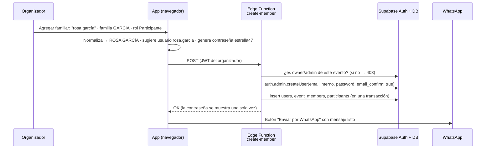

# 3. Permisos y seguridad

> Arquitectura v1: solo frontend + Supabase. **El navegador no es de confianza.** Toda regla de permisos vive en
> PostgreSQL (RLS y funciones RPC) y en Edge Functions de Supabase para lo que necesita la clave de servicio.
> El frontend solo oculta botones para que la interfaz sea clara.

## 3.1. Roles

| Rol | Quién es | Cómo entra |
|---|---|---|
| **Organizador** (`owner`) | Creó el evento. Hay uno solo. | Se registra con correo y contraseña. |
| **Administrador** (`admin`) | Co-organizador con los mismos poderes, salvo borrar el evento o quitar al organizador. | Usuario creado por el organizador. |
| **Editor** (`editor`) | Ayuda a organizar: responsabilidades, cronograma, anuncios, juegos. | Usuario y contraseña creados por el organizador o un administrador. |
| **Participante** (`participant`) | Cualquier familiar. | Usuario y contraseña creados por el organizador o un administrador. |
| **Tutor** (relación, no rol) | Padre o madre que administra los perfiles de sus hijos. El hijo puede tener usuario propio o no; si lo tiene, ambos pueden editar sus regalos. | Su propio usuario. |

## 3.2. Usuarios creados por el administrador

No hay registro libre: **solo el organizador (o un administrador) crea las cuentas** de los familiares.



Mensaje propuesto:

> ¡Hola, ROSA! 🎄 Estamos organizando nuestra Navidad familiar.
> Entra aquí para elegir tus regalos y ver las actividades: https://…
> 🏠 **Código de tu Navidad:** GARCIA25
> 👤 **Usuario:** rosa
> 🔑 **Contraseña:** estrella4821

Detalles:

- **Código de la Navidad + usuario:** cada Navidad tiene un código (`GARCIA25`) elegido por el organizador, y los
  usuarios son únicos solo dentro de esa Navidad. Así dos familias distintas pueden tener cada una su `rosa`.
  El código no da acceso por sí solo: siempre hace falta la contraseña.
- **Supabase Auth exige un correo**, así que cada usuario recibe un correo interno ficticio
  (`rosa@garcia25.usuarios.navidad.invalid`). **Nunca se envían correos** (el dominio `.invalid` no existe) y la
  persona nunca lo ve. Esto queda encapsulado en `SupabaseAuthService` y en la Edge Function `create-member`.
- Crear cuentas requiere la clave `service_role`, que **no puede estar en el navegador**. Por eso se hace en una
  **Edge Function de Supabase**. Se despliega con la CLI de Supabase y no es un servidor que haya que mantener.
- **Usuario:** se sugiere automáticamente (`rosa`; si ya existe en la Navidad, `rosa.garcia` y luego `rosa2`) y el
  administrador puede cambiarlo. Al iniciar sesión no importan mayúsculas ni espacios.
- **Contraseña:** el administrador la escribe o la app la genera fácil de dictar (palabra navideña + 2 números,
  mínimo 8 caracteres). **No se guarda en texto plano**: se muestra una sola vez, al crear o restablecer.
- **¿Olvidó su contraseña?** La pantalla dice "Pídele una nueva a ‹organizador›". El administrador toca
  **Restablecer contraseña** (Edge Function `reset-member-password`) y envía la nueva por WhatsApp.
- **Sesión larga:** después de entrar una vez, el teléfono recuerda la sesión (Supabase renueva el token) y no
  vuelve a pedir la contraseña, salvo que se cierre sesión o se borren los datos del navegador.
- **Desactivar a alguien:** Edge Function `disable-member` (bloquea la cuenta y cierra sus sesiones).
- Las Edge Functions están en `supabase/functions/`, verifican el JWT y el rol en cada llamada, y registran la acción en `audit_log`.

**Lo que se cede** (aceptable en un evento familiar): el administrador conoce la contraseña inicial de cada familiar.
Mitigación: cada persona **puede** cambiarla desde Perfil (no es obligatorio, para no complicar a los mayores) y
conviene enviarla por chat individual, no en el grupo.

## 3.3. Matriz de permisos

✅ permitido · 🔸 solo lo propio y lo de las personas a su cargo · 👁️ solo ver · ❌ prohibido

| Acción | Organizador / Admin | Editor | Participante | Tutor (además) |
|---|---|---|---|---|
| Configurar evento y presupuesto | ✅ | ❌ | ❌ | — |
| Crear usuarios, asignar roles, restablecer contraseñas | ✅ | ❌ [PROPUESTA D16] | ❌ | — |
| Crear/editar familias y participantes | ✅ | ❌ | ❌ | — |
| Asignar tutores | ✅ | ❌ | ❌ | — |
| **Mis regalos**: agregar, editar, eliminar (título, descripción, enlaces, precio) | ✅ (de cualquiera) | 🔸 | 🔸 | 🔸 personas a cargo |
| Ver listas de deseos de todos | ✅ | ✅ | ✅ | ✅ |
| Registrar el amigo secreto | ✅ | ❌ | ❌ | — |
| Ver asignaciones de otros | ✅ solo si no están selladas | ❌ | ❌ | — |
| Descubrir **mi** amigo secreto | ✅ (el suyo) | 🔸 | 🔸 | 🔸 el de cada persona a cargo |
| Crear/editar/borrar responsabilidades y aportes | ✅ | ✅ | ❌ | — |
| Ver responsabilidades de todos | ✅ | ✅ | 👁️ | 👁️ |
| **Marcar como hecha** una responsabilidad | ✅ | ✅ | 🔸 solo si es suya o de su familia | 🔸 |
| Crear/editar cronograma y anuncios | ✅ | ✅ | 👁️ | 👁️ |
| **Agregar ideas** de juegos o actividades (entran directo, sin aprobación) | ✅ | ✅ | ✅ | ✅ |
| Editar o quitar **mi** idea de juego | ✅ | ✅ | 🔸 | 🔸 |
| Editar cualquier juego, **fusionar** juegos parecidos, abrir/cerrar votaciones | ✅ | ✅ | ❌ | — |
| Votar juegos | ✅ | ✅ | 🔸 | 🔸 un voto por cada persona a cargo |
| Ruleta "¡Sorpréndenos!" | ✅ (y elegir manualmente) | ✅ | ✅ | ✅ |
| Checklist general: crear tareas | ✅ | ✅ | ❌ | — |
| Marcar mi checklist | ✅ | ✅ | 🔸 | 🔸 |
| Cambiar mi propia contraseña | ✅ | ✅ | ✅ | ✅ |

La matriz se implementa como **políticas RLS** (fuente de verdad) y se refleja en la interfaz: un participante no ve
botones de "Agregar responsabilidad".

Marcar una responsabilidad como hecha usa la RPC `mark_responsibility_done(id)`, que comprueba que la persona
sea responsable y **solo** cambia el estado. Así un participante no puede editar el título ni la fecha mediante una
actualización directa de la tabla.

## 3.4. Políticas RLS (ejemplos)

```sql
-- helpers (security definer, search_path = '')
app.my_event_ids()              -- eventos donde auth.uid() es miembro
app.my_role(event_id)           -- owner | admin | editor | participant
app.acting_participant_ids()    -- mi perfil + personas a mi cargo

create policy wishlist_select on wishlist_items for select
  using (event_id in (select app.my_event_ids()));

create policy wishlist_write on wishlist_items for all
  using      (participant_id in (select app.acting_participant_ids()) or app.my_role(event_id) in ('owner','admin'))
  with check (participant_id in (select app.acting_participant_ids()) or app.my_role(event_id) in ('owner','admin'));

create policy resp_select on responsibilities for select
  using (event_id in (select app.my_event_ids()));
create policy resp_manage on responsibilities for all
  using (app.my_role(event_id) in ('owner','admin','editor'));
-- participantes: sin UPDATE directo → RPC mark_responsibility_done
```

**Pruebas RLS** (pgTAP, en CI): para cada tabla y RPC, con organizador, administrador, editor, participante y
tutor del evento A, participante del evento B y usuario sin sesión. Una prueba falla si alguna tabla no tiene RLS.

## 3.5. Amigo secreto

- `secret_assignments` sin política de lectura para participantes ni editores. La única vía es la RPC
  `reveal_my_secret_friend(giver_id)`, que verifica que `giver_id` esté en `app.acting_participant_ids()`.
- Al **sellar** el sorteo, ni el organizador ve las parejas (solo conteos). Abrir el sello pide confirmación y queda registrado.

## 3.6. Seguridad web

| Riesgo | Medida |
|---|---|
| Acceso directo con la clave pública | RLS en todas las tablas, RPC para lo sensible y pruebas pgTAP. |
| `service_role` | Solo dentro de las Edge Functions (secreto de Supabase). Nunca en variables `VITE_*`; CI revisa el bundle. |
| Edge Functions | Verifican el JWT y el rol en el evento en cada llamada; validan la entrada con Zod; sin CORS abierto (solo el dominio de la app). |
| Adivinar contraseñas | Límites de intentos de Supabase Auth por IP; contraseñas de 8 caracteres o más; se puede activar CAPTCHA si hiciera falta. |
| SQL Injection | Consultas parametrizadas (supabase-js); RPC sin SQL dinámico con datos del usuario. |
| XSS | React escapa por defecto; sin `dangerouslySetInnerHTML`; anuncios y descripciones en texto plano; enlaces solo `http(s)` y abiertos con `rel="noopener noreferrer"`; CSP en Render. |
| Enlaces maliciosos en regalos | Solo `http/https`; se muestra el dominio ("saga.falabella.com.pe") junto al enlace. |
| Sesión en el teléfono | JWT en `localStorage`; mitigado con CSP estricta y sin scripts de terceros. |
| Datos de menores | Perfiles sin usuario, solo nombre. |
