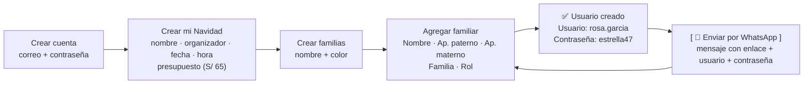
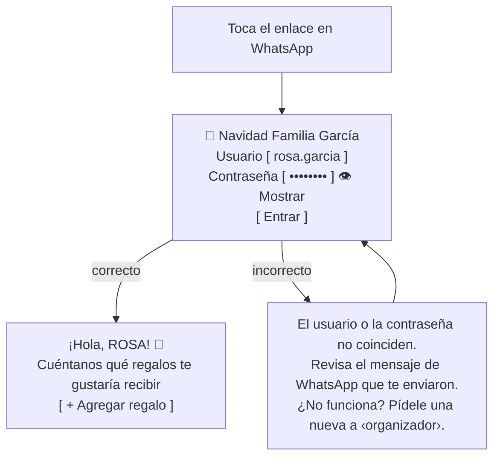
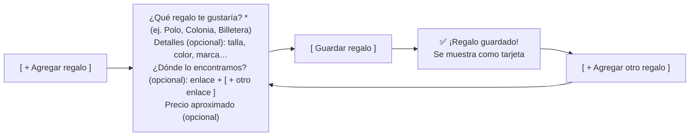
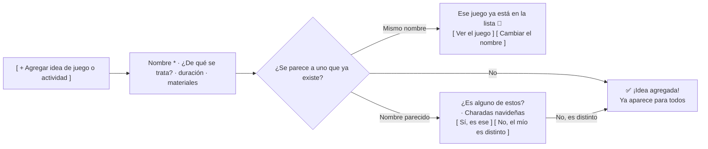

# 4. Flujos de usuario

Objetivo de diseño: **mínimo de pasos** y **una acción principal por pantalla**.

## 4.1. Organizador: preparar el evento y entregar accesos

Para agilizar: después de crear a una persona, el formulario queda listo para la siguiente (conservando la familia elegida).

En la lista de familiares, cada persona tiene botones grandes: **Enviar acceso por WhatsApp** · **Nueva contraseña** · **Editar**.

## 4.2. Familiar: entrar por primera vez

- Tolerancia: el usuario se acepta con mayúsculas o espacios accidentales (`Rosa.Garcia ` → `rosa.garcia`).
- **Mostrar contraseña** activado por defecto [PROPUESTA], porque las personas mayores se equivocan al escribir a ciegas.
- Después de entrar, el teléfono recuerda la sesión: la próxima vez el enlace abre directo en Inicio.

## 4.3. Familiar: registrar regalos (flujo principal)

- Solo el nombre del regalo es obligatorio.
- Hasta 5 enlaces por regalo; se muestra el dominio de cada enlace para que se entienda adónde lleva.
- Si el precio supera el presupuesto: aviso amable, **no bloquea** [PROPUESTA D11].
- Cada tarjeta tiene botones grandes **Editar** y **Eliminar** (con confirmación "¿Seguro que quieres quitar este regalo?").
- **Sin fotos en la v1.**

## 4.4. Familiar: responsabilidades

- Ve **todas** las responsabilidades del evento, con filtros por familia, persona y estado.
- Arriba aparecen **"Mis responsabilidades"** (las suyas y las de su familia), cada una con el botón **[ ✓ Ya lo hice ]**.
- No ve botones para crear ni editar: eso lo hacen el organizador, los administradores y los editores.

## 4.5. Familiar: agregar ideas de juegos y votar

- **Sin aprobación:** la idea aparece para todos en el momento.
- **No se permiten dos juegos con el mismo nombre.** Si el nombre es parecido, se sugiere el existente, pero la persona decide.
- Con la votación abierta: tarjetas con **[ 👍 Votar ]** (hasta 3 votos) y el ranking en vivo.

### Administrador o editor: fusionar juegos parecidos

Cuando dos o más ideas son casi la misma dinámica con distinto nombre (X y Y):

1. Las marca en la lista y toca **[ Unir juegos ]**.
2. Elige si **se queda con uno** de ellos o **crea uno nuevo (Z)** que combine ambas dinámicas. El formulario se
   rellena con los datos de X y Y para editarlo.
3. Guarda. X y Y desaparecen de la lista y de la ruleta, y Z muestra "Idea de: JUAN, MARÍA".
4. Los votos de X y Y pasan a Z, contando **una sola vez** a quien había votado por los dos [PROPUESTA D20].

## 4.6. Niños: con su propio usuario o a través de sus padres (D7)

- El organizador crea el perfil del niño y decide si **tiene usuario propio** (si sabe usar el teléfono) o no.
- En ambos casos puede asignar al padre o a la madre como **tutor**.
- En **Mis regalos** el tutor ve un selector grande: **¿De quién son estos regalos?** ( Yo ) ( JUAN ) ( MARÍA ).
  Quien no es tutor no ve el selector.
- Si el niño tiene usuario, él y su tutor pueden agregar y editar sus regalos.

## 4.7. Inicio del participante

1. Cuenta regresiva en la zona horaria del evento.
2. Anuncio importante (si hay).
3. "Te falta…": checklist con % de progreso y accesos directos.
4. Mis regalos (botón Agregar).
5. Mi amigo secreto (botón Descubrir).
6. Mis responsabilidades (botón Ya lo hice).
7. Color de mi familia / vestimenta.
8. Juegos y actividades.

Navegación inferior: **Inicio · Regalos · Actividades · Celebración · Perfil**. El botón **Organizar** aparece solo
para organizador, administradores y editores, y cada uno ve solo las secciones de su rol.

## 4.8. Escenarios de usabilidad

| # | Escenario | Recorrido | Toques aprox. |
|---|---|---|---|
| 1 | Persona de 70 años registra 3 regalos | Enlace → escribe usuario y contraseña → Entrar → (+ Agregar → escribe → Guardar) ×3 | 3 + 9 = **12** la primera vez; luego entra directo |
| 2 | Escribe en minúsculas, con espacios y tildes | Lo hace el administrador al crearla; se normaliza solo: "rosa  garcía" → ROSA GARCÍA | 0 extra |
| 3 | Padre registra los deseos de sus 2 hijos | Regalos → elige hijo → agrega | ~2 + regalos |
| 4 | Sin correo electrónico | No se pide: usuario y contraseña creados por el administrador | 0 |
| 5 | Dos familiares con el mismo nombre | Al crearlos, el administrador ve "Ya existe ROSA GARCÍA" y agrega un dato que los diferencie (MADRE/HIJA); los usuarios son distintos (`rosa.garcia`, `rosa.garcia2`) | +1 |
| 6 | Abre en WhatsApp y continúa en el navegador | Si cambia de navegador, vuelve a escribir usuario y contraseña (siguen en el chat de WhatsApp) | 3 |

Las pruebas con personas mayores (Fase 6) medirán si completan la tarea sin ayuda, el tiempo, los errores y las
dudas, con al menos 3 personas de más de 65 años en sus propios teléfonos.
